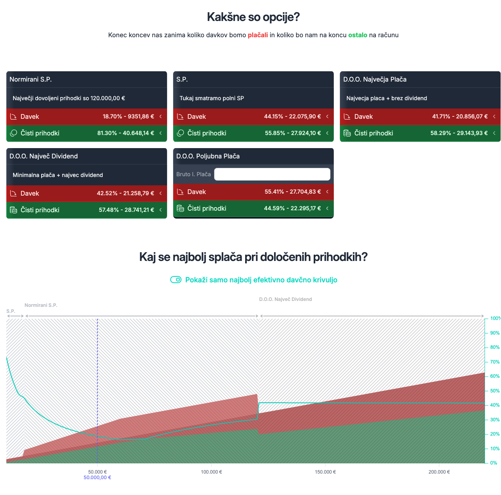

# obdavcen.si

**Live: [obdavcen.si](https://obdavcen.si)**

A Slovenian tax calculator for freelancers and remote workers. Enter your yearly
revenue and expenses and it compares how much you pay in taxes and contributions,
and how much you keep, as a **normirani s.p.**, a regular **s.p.**, or a
**d.o.o.** with different salary/dividend strategies.

> Kalkulator davkov za samostojne podjetnike in delavce na daljavo. Primerja
> normirani s.p., s.p. in d.o.o. ter pokaže, katera oblika se pri tvojih
> prihodkih in stroških najbolj splača.

[](https://obdavcen.si)

## Features

- Side-by-side comparison of normirani s.p., s.p., and d.o.o. (maximum salary,
  minimum salary with maximum dividends, or a custom gross salary)
- Chart of the effective tax rate across income levels, highlighting the most
  efficient option at each point
- Detailed breakdown of prispevki (social security contributions), dohodnina
  (income tax), and corporate tax for each option
- Extra settings: last year's contributions, meal and travel allowances, regres,
  božičnica, performance bonus, additional pension insurance, and other tax relief
- Tax constants per year (2025, 2026), each with links to official sources
- Explainer articles (in Slovenian) on how to pay yourself out under each entity type

The site, articles, and tax terminology are in Slovenian.

> [!WARNING]
> The calculations are informative only and may contain mistakes. They are not
> tax advice. Talk to an accountant before making decisions.

## Development

Requires Node.js 20+ and Yarn 1.

```sh
yarn install
yarn dev        # http://localhost:5173
```

Other commands:

```sh
yarn lint       # ESLint
yarn typecheck  # tsc
yarn build      # production build
yarn start      # serve the production build
```

### Docker

```sh
docker build -t obdavcen .
docker run -p 3000:3000 obdavcen
```

### Environment variables

All optional. Without them, everything except the newsletter form works.

| Variable              | Purpose                                    |
| --------------------- | ------------------------------------------ |
| `MAILERLITE_API_KEY`  | MailerLite API key for the newsletter form |
| `MAILERLITE_GROUP_ID` | MailerLite group new subscribers join      |

## How it works

Built with [Remix](https://remix.run) (Vite), React, TypeScript, Tailwind CSS +
DaisyUI, [visx](https://airbnb.io/visx/) for charts, and MDX for articles.

```
app/
├─ constants/<year>/   # Tax brackets, contribution rates, relief amounts per year
├─ utils/taxCalculator/ # One calculator per entity type
├─ utils/prispevki.ts  # Social security contributions
├─ utils/dohodnina.ts  # Progressive income tax and relief
├─ utils/taxModes.ts   # Registry of entity types used by the chart and cards
├─ routes/             # Pages and MDX articles (izplacilo.*.mdx)
└─ ui/                 # Shared components and page components
```

To add a new tax year, copy the latest folder in `app/constants/`, update the
values (with sources in comments), and register it in `app/constants/index.ts`.

See [CLAUDE.md](CLAUDE.md) and [CONVENTIONS.md](CONVENTIONS.md) for code
conventions, and [DIRECTIONS.md](DIRECTIONS.md) for writing articles.

## Contributing

Spotted a wrong number or an outdated rate? Open an issue or a pull request,
ideally with a link to the official source (FURS, ZPIZ, zakonodaja.com, ...).

## License

[AGPL-3.0](LICENSE). If you run a modified version of this app as a public
service, you must publish your source code.
